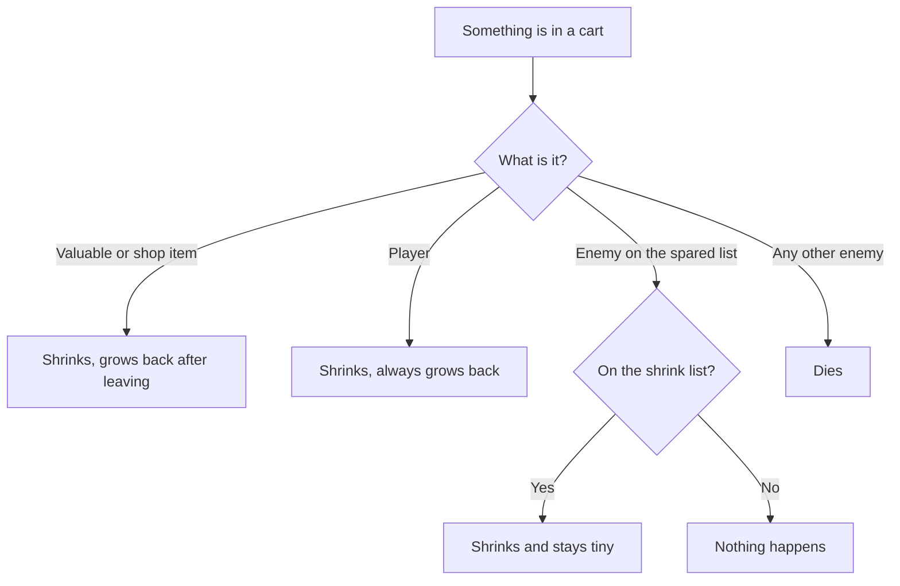

# Tiny Cart

A shrinking cart for R.E.P.O. that stays calm: things go small when they go in the cart and stay small until you take them out.

## What it does

- **Valuables, shop items and cosmetic boxes** shrink to 40% of their size in any cart and weigh less, so a full cart is easier to push. They grow back about 1.5 seconds after leaving the cart.
- **Big things shrink further until they fit.** Nothing in a cart stays longer than 0.8 m, so a grandfather clock or a traffic light ends up small enough to lie in the basket.
- **No flickering.** A shrunk valuable does not pop back to full size when it gets bumped or loses value, and nothing changes size while it sits on the cart's edge.
- **Enemies that touch the cart die**, except the ones on the spared list.
- **Ducks and gnomes are spared and shrink instead.** They go down to half size and stay tiny for the rest of the level.
- **Players** standing or lying in the big cart shrink, and always grow back after they leave it.

Pairs nicely with [FriendlyDuck](https://thunderstore.io/c/repo/p/purplehaxttv/FriendlyDuck/).


## Settings

Everything can be changed in the in-game mod settings (with REPOConfig installed) or in `BepInEx/config/purplehaxttv.TinyCart.cfg`.

| Section | Setting | Default | What it does |
| --- | --- | --- | --- |
| Valuables | Scale | 0.4 | Size of a valuable in a cart |
| Valuables | Lighter when small | true | Shrunk things weigh less |
| Items | Shrink shop items | true | Bought items shrink too |
| Items | Scale | 0.4 | Size of a bought item in a cart |
| Cosmetics | Shrink cosmetic boxes | true | Cosmetic boxes found in levels shrink too, at the valuables scale |
| General | Largest size in cart | 0.8 | Longest side in metres anything may keep in a cart; bigger things shrink further. 10 = off |
| General | Grow back when removed | true | Off keeps things small for the rest of the level |
| General | Grow back delay | 1.5 | Seconds out of the cart before growing back |
| General | Shrink speed | 2 | How fast the size change plays |
| General | Active in shop | false | Shrink things in the shop's cart |
| Enemies | Kill enemies in cart | true | Enemies touching the cart die |
| Enemies | Enemies spared | Duck,Apex Predator,Gnome | Enemies the cart never kills |
| Enemies | Kill reach | 0.3 | How far outside the basket still counts as a hit, in metres |
| Enemies | Enemies to shrink | Duck,Apex Predator,Gnome | Enemies that shrink in a cart. `Name=size` gives one its own size |
| Enemies | Scale | 0.5 | Size for listed enemies without their own size |
| Enemies | Grow back when out of cart | false | Off keeps a shrunk enemy small for the level |
| Enemies | Grow back when hurt | false | A shrunk enemy grows back on damage |
| Players | Shrink players in cart | true | Players in the big cart shrink |
| Players | Scale | 0.5 | Size of a player in a cart |
| Players | Grow back when hurt | true | A shrunk player grows back on damage |

## Multiplayer

The host decides what shrinks and what dies, and the host's settings apply. Everyone should have the mod and ScalerCore installed so sizes look the same for all players.

## Good to know

- The game only checks a cart's contents while a player is within 12 metres, so a cart left far away will not shrink new things until someone walks up.
- Do not run it together with another shrink cart mod.
- Requires [ScalerCore](https://thunderstore.io/c/repo/p/Vippy/ScalerCore/).

## Build

The project builds against the game's own assemblies and ScalerCore, so it needs R.E.P.O. and a mod profile with BepInEx and ScalerCore on the machine.

```
dotnet build TinyCart.csproj -c Release -p:GameDir="<path to REPO>" -p:ProfileDir="<path to the mod profile>"
```

`Dev/` holds a test harness that is not shipped. It starts a solo run, fills the cart with valuables, a duck, gnomes and another enemy, and logs what happens.

## License

MIT